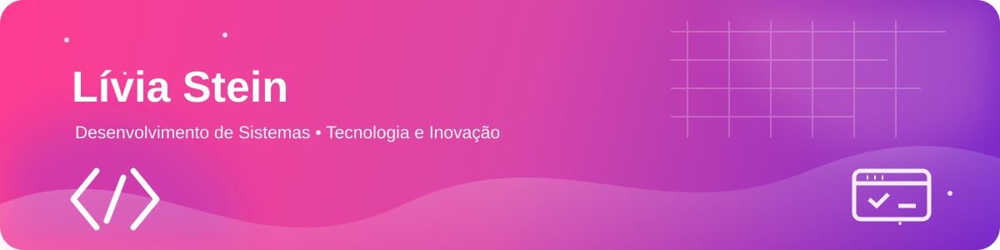

<div align="center">
  
</div>

<br />

<div align="center">
  <h1>Olá! Eu sou a Lívia Stein 👋</h1>
  <p><strong>Estudante de Desenvolvimento de Sistemas · Criadora em formação · Apaixonada por tecnologia</strong></p>
  <p>
    Transformo curiosidade em código e ideias em projetos.<br />
    Estou sempre a aprender algo novo e a dar mais um passo na minha jornada na tecnologia.
  </p>
</div>

<p align="center">
  <a href="https://github.com/livia-steinn">
    
  </a>
  
  
</p>

---

## Sobre mim

Sou estudante do curso de **Desenvolvimento de Sistemas** na escola **SENAI Luiz Varga**. Tenho interesse em programação, desenvolvimento web e em descobrir como a tecnologia pode transformar ideias em soluções práticas.

Este perfil é o meu espaço de aprendizagem. Aqui reúno atividades, experiências, estudos e projetos desenvolvidos ao longo da minha formação. Cada repositório representa uma etapa da minha evolução e uma oportunidade de aprender algo novo.

> **A melhor forma de aprender tecnologia é praticar, testar, errar, corrigir e continuar.**

## A minha jornada na tecnologia

```text
Fundamentos        ████████████████████░░  em evolução
Desenvolvimento web ████████████████░░░░░░  a explorar
Lógica de código    ███████████████░░░░░░░  a fortalecer
Projetos práticos   █████████████░░░░░░░░░  em construção
```

## Tecnologias e ferramentas

### Linguagens e desenvolvimento

<p>
  
  
  
  
</p>

### Ferramentas e ambiente

<p>
  
  
  
</p>

## O que estou a aprender

- Construção de páginas e interfaces com **HTML**;
- Lógica de programação e resolução de problemas;
- Interatividade e funcionalidades com **JavaScript**;
- Fundamentos de programação com **Python**;
- Conceitos de backend e organização de sistemas;
- Versionamento e partilha de projetos no **GitHub**;
- Boas práticas para escrever código mais claro e organizado.

## Projetos em destaque

### 📚 [1termo](https://github.com/livia-steinn/1termo)

Conteúdos de aulas, atividades e materiais do primeiro termo de Desenvolvimento de Sistemas, incluindo estudos de **Python**.

### 🌐 [DEVIS](https://github.com/livia-steinn/DEVIS)

Projeto e conteúdos desenvolvidos com **HTML**, explorando a estruturação de páginas web.

### 🧩 [2TERMO](https://github.com/livia-steinn/2TERMO)

Repositório do segundo termo do curso, com atividades e práticas de desenvolvimento em **HTML**.

### ⚡ [JavaScript](https://github.com/livia-steinn/JavaScript)

Estudos, exercícios e experiências com **JavaScript**, lógica e interatividade para a web.

### 🛠️ [Programacao-Backend](https://github.com/livia-steinn/Programacao-Backend)

Conteúdos e práticas relacionados com programação backend, utilizando **JavaScript**.

### 🔎 [DEVIS_1](https://github.com/livia-steinn/DEVIS_1)

Mais uma etapa da minha formação e dos meus experimentos no desenvolvimento de sistemas.

<p align="center">
  <a href="https://github.com/livia-steinn?tab=repositories">
    
  </a>
</p>

## Foco atual

<div align="center">
  <h3>🚀 Aprender · Criar · Evoluir</h3>
  <p>Estou a transformar cada aula e cada exercício numa nova oportunidade para construir o meu futuro na tecnologia.</p>
</div>

```javascript
const livia = {
  area: "Desenvolvimento de Sistemas",
  interesses: ["programação", "web", "tecnologia"],
  estudando: ["Python", "HTML", "JavaScript", "backend"],
  objetivo: "evoluir um pouco todos os dias"
};
```

## Próximos objetivos

- Criar projetos web cada vez mais completos;
- Aprofundar os fundamentos de JavaScript;
- Evoluir na programação backend;
- Organizar melhor os meus projetos e estudos;
- Continuar a construir um portfólio com a minha identidade.

## Vamos conectar ideias através da tecnologia

<p align="center">
  <strong>Obrigada pela visita!</strong><br />
  Se gostaste de acompanhar a minha jornada, explora os meus repositórios e vê como estou a evoluir projeto a projeto.
</p>

<div align="center">
  <br />
  
  
  <br /><br />
  <strong>Code, criatividade e tecnologia — um projeto de cada vez.</strong>
</div>
